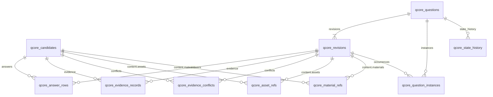

# QCORE-02-01 — Question Core 最小 PostgreSQL 持久化 执行报告

## 0. 验收结论

**通过。** Question Core 已从"纯契约模型"迈出真实持久化第一步：

- 一个真实、隔离的 PostgreSQL 数据库 `qcore_dev_test` 中，已完整持久化 Question Core 聚合（含复合题、Typed Answer、Evidence、表格、Asset 引用）。
- 断开连接、销毁连接池、重建引擎后，数据仍能准确读取并恢复为原契约对象（`restored == original`，含审批/发布状态）。
- QCORE-01 的 279 项契约测试回归全部通过，Schema Hash 与 Golden snapshots 均未变化。
- 本轮未修改任何契约文件、Golden、JSON Schema，未触碰任何 `aitutors*` 既有数据库，未修改 DeepTutor / Preprocessing。

测试总计 **354 通过 / 0 失败**（QCORE-01 原有 279 + 持久化单元 29 + PostgreSQL 集成 46）。

## 1. 实际新增和修改文件

### 新增（21 个代码/配置文件 + 1 份报告）

| 文件 | 作用 |
|---|---|
| `question_core/persistence/__init__.py` | 持久化层公共出口 |
| `question_core/persistence/config.py` | 环境变量配置 + 保护库拒绝 |
| `question_core/persistence/exceptions.py` | 持久化错误体系 |
| `question_core/persistence/engine.py` | Engine / 事务 Session / 健康检查 |
| `question_core/persistence/models.py` | SQLAlchemy 2.0 表定义 + 不可变触发器 DDL |
| `question_core/persistence/serialize.py` | 契约 ⇄ payload 序列化与再校验 |
| `question_core/persistence/repository.py` | Repository 与事务操作 |
| `alembic.ini` | Alembic 配置（不含任何凭据） |
| `migrations/env.py` | Alembic 环境（URL 取自环境变量） |
| `migrations/script.py.mako` | Alembic 脚本模板 |
| `migrations/versions/1230cc4692f1_initial_qcore_schema.py` | 初始 Migration |
| `pytest.ini` | 注册 `pg` 测试标记 |
| `tests/persistence/__init__.py` | 测试包 |
| `tests/persistence/synthetic.py` | 合成契约测试数据（全部由契约模型构造） |
| `tests/persistence/test_serialize.py` | 序列化单元测试（20 项） |
| `tests/persistence/test_config.py` | 配置单元测试（9 项） |
| `tests/persistence/integration/__init__.py` | 集成测试包 |
| `tests/persistence/integration/conftest.py` | 真实 PostgreSQL 夹具 |
| `tests/persistence/integration/test_pg_roundtrip.py` | 往返/读取/重启测试 |
| `tests/persistence/integration/test_pg_transactions.py` | 事务回滚/重复写入/不可变性测试 |
| `tests/persistence/integration/test_pg_migration.py` | Migration 生命周期测试 |

测试产物：`results_qcore02_baseline.xml`、`results_qcore02_regression.xml`、`results_qcore02_full.xml`。

### 修改

**无。** `git status` 显示除上述新增外没有任何 `M` 条目：
`question_core/contracts/**`、`question_core/golden/**`、`question_core/schema/**`、
`tests/`（QCORE-01 原有 279 项测试文件）全部原样未动。

## 2. 契约兼容性说明（无法直接持久化的结构）

按任务要求，先指出契约中无法直接 JSON 往返的结构，**不修改契约绕过**：

- **模型/字段**：`question_core/contracts/v1/question.py` → `Revision.explanation_blocks: tuple`（无类型标注）。
- **原因**：`Revision.model_dump(mode="json")` 将其中的契约对象降为 dict；`Revision.model_validate` 反序列化时该字段按 `tuple[Any, ...]` 接收，条目停留在 dict 形态，随后 `_state_binding` 校验器调用
  `canonical_content_hash(content, *answers, *explanation_blocks)`，对 dict 取 `.model_dump()` 直接
  `AttributeError`。即：**非空 explanation_blocks 的 Revision 无法经纯 JSON 恢复**。
- **现状**：QCORE-01 的 279 项测试与 Golden 均未覆盖非空 `explanation_blocks`（Golden 中为空数组），故未暴露。
- **持久化层处理**（不改契约）：`persistence/serialize.py::restore_revision` 在 `model_validate` 之前，
  用契约自己导出的 `content_block_adapter`（或 `typed_answer_adapter`）把 dict 条目水合回契约模型；
  遇到无 `kind`/`answer_type` 识别符的条目则抛出 `ContractViolationError`（明确报错，不猜类型）。
  单元测试 `test_explanation_blocks_rehydrated`、`test_unknown_explanation_block_rejected` 与集成测试
  `test_evidence_composite_asset_table_restore`（含 TextBlock/MathBlock/TableBlock 三种解析块）已验证
  往返一致且 `content_hash` 复核一致。
- **建议**（留给 Owner 裁定，本轮不改）：后续契约版本可将该字段收紧为
  `tuple[ContentBlock, ...]` 或 `tuple[Annotated[Union[...], Field(discriminator="kind")], ...]`。

其余全部模型（Candidate 双分支、TypedAnswer 9 种、QuestionContent 复合树、表格、Asset、
EvidenceBundle、StateSnapshot、QuestionAggregate）均可经纯 JSON + `model_validate` 完整往返。

## 3. 数据库表结构及对象关系

命名空间：全部表以 `qcore_` 前缀建于独立数据库 `qcore_dev_test`。关系表承载身份/生命周期/归属关系，
每个对象同时保存 `payload JSONB`（即 `model_dump(mode="json")` 原文）作为**权威还原源**——读取一律
经 payload 反序列化并完整重跑契约校验，杜绝类型转换失真；关系列/子表是查询投影与约束载体。



### 核心表

| 表 | 主键 | 关键列 / 约束 |
|---|---|---|
| `qcore_candidates` | `candidate_id` | `idempotency_key` UNIQUE；`source_type`、`question_type`、`completeness`、`ingestion_run_id`、`adapter_version` 投影列；`payload` JSONB；`contract_created_at` |
| `qcore_questions` | `question_id` | `identity_fingerprint`、`embedding_ref`、`contract_created_at` |
| `qcore_revisions` | `revision_id` | FK `question_id`；UNIQUE(`question_id`,`revision_number`)；`content_hash`、`question_type`、三态投影列（`completeness`/`review_state`/`publication_state`）、`state` JSONB、`payload` JSONB；**BEFORE UPDATE OR DELETE 触发器 `qcore_revisions_immutable`** |
| `qcore_question_instances` | `instance_id` | FK `question_id`、`revision_id`；UNIQUE(`question_id`,`source_document_id`,`ordinal`) 出现位约束；`question_numbers INT[]`、行号、`payload` JSONB |
| `qcore_state_history` | 自增 `id` | FK `question_id`；UNIQUE(`question_id`,`position`)；`snapshot` JSONB（追加式） |

### 投影/引用子表（`candidate_id` / `revision_id` 二选一外键 + CHECK，均为"完整保留结构与归属关系"）

| 表 | 唯一约束（按 owner 部分索引） | 保留内容 |
|---|---|---|
| `qcore_answer_rows` | (owner, `position`) | 每个 TypedAnswer 的 `answer_type`、`completeness`、完整 `payload` |
| `qcore_evidence_records` | (owner, `evidence_id`) | `target_path`、`evidence_role`、`evidence_status`、完整 `payload`（locator/raw_value 等） |
| `qcore_evidence_conflicts` | (owner, `conflict_id`) | `target_path`、`is_critical`、`resolution`、完整 `payload`（evidence_ids 归属关系在 payload 内） |
| `qcore_asset_refs` | (owner, `asset_id`) | `storage_path`、`content_hash`、`mime_type`——仅资源标识与关联，不复制、不处理媒体文件 |
| `qcore_material_refs` | (owner, `material_id`) | Material 完整 `payload`（含块结构） |

为后续生命周期预留：`qcore_state_history` 追加式设计可承载审批/发布事件（规则 9 历史保留），
`qcore_revisions` 三态投影列可支撑生命周期查询；本轮不实现审批服务，但未破坏其扩展路径。

## 4. Migration 版本和执行结果

- 工具：Alembic 1.18.4；版本文件 `migrations/versions/1230cc4692f1_initial_qcore_schema.py`
  （`<base> -> 1230cc4692f1 (head), initial qcore schema`）。
- URL 不落盘：`alembic.ini` 的 `sqlalchemy.url` 为空，`env.py` 从环境变量经
  `question_core.persistence.config` 取连接串。

| 验证项 | 执行方式 | 结果 |
|---|---|---|
| 空库从头初始化 | 对全新库 `qcore_dev_test_migrate` 执行 `alembic upgrade head` | 10 张 `qcore_*` 表 + 触发器全部创建 ✅ |
| 版本有明确记录 | `SELECT version_num FROM alembic_version` | `1230cc4692f1` ✅ |
| 重复执行不破坏数据 | 插入一行 → 再次 `upgrade head` → 复查 | 行仍在，版本不变 ✅ |
| 主测试库重复升级保数据 | 写入聚合 → 再次 `upgrade head` → 重读 | 聚合完整一致 ✅ |
| 不以删库/重建掩盖问题 | 检查全部版本脚本 | 无 `DROP/CREATE DATABASE` 语句；`downgrade()` 只回收本 Migration 创建的对象 ✅ |

## 5. Repository 实际实现的操作

`question_core/persistence/repository.py::QuestionCoreRepository`（所有操作在调用方 Session 事务内，
`session_scope()` 提交/回滚边界；每次写入末尾 `flush()` 让约束错误在调用点暴露）：

| 类别 | 方法 | 说明 |
|---|---|---|
| Candidate 写 | `save_candidate(candidate)` | 含 answers/evidence/asset/material 投影，同事务 |
| Candidate 读 | `get_candidate(candidate_id)` / `get_candidate_by_key(idempotency_key)` | payload 还原 + 契约再校验 |
| Question 写 | `create_question(identity)` / `save_question_aggregate(aggregate)` | 聚合写 = 身份 + 全部 Revision + Instance + state_history |
| Question 读 | `get_question_identity(question_id)` / `get_question_aggregate(question_id)` | 聚合还原后自动跑 `QuestionAggregate` 一致性规则 |
| Revision 写 | `add_revision(revision)`（追加） | 追加式；同号/同 id 被唯一约束拒绝 |
| Revision 读 | `get_revision(revision_id)` / `list_revisions(question_id)` | 内容哈希绑定在还原时重新验证 |
| Instance 写 | `add_instance(instance)` | 出现位唯一约束防重复 |
| Instance 读 | `get_instance(instance_id)` / `list_instances(question_id)` | |
| 组合事务写 | `save_candidate_with_question(candidate, aggregate)` | Candidate 与关联对象一个事务，失败整体回滚 |

错误转译：`IntegrityError` → `DuplicateCandidateError` / `DuplicateQuestionError` /
`DuplicateRevisionError` / `DuplicateInstanceError` / `NotFoundError`；读回校验失败 →
`ContractViolationError`；配置缺失 → `ConfigurationError`；连接失败 → `DatabaseConnectionError`
（`health_check()` 探测 `SELECT version()/current_database()/current_user`）。

## 6. PostgreSQL 真实测试结果

**禁止 SQLite/Mock**：全部集成测试直连 PostgreSQL 16.15（Docker `aitutor-postgres`），
`tests/persistence/integration/conftest.py` 在缺少环境变量时直接 `pytest.fail`（不静默跳过）。

```
python -m pytest tests/persistence/integration -q
46 passed in 24.92s
```

十项指定验证与测试对应：

| # | 指定验证 | 测试 | 结果 |
|---|---|---|---|
| 1 | 创建 Candidate 写入 PostgreSQL | `TestCandidatePersistence::test_save_and_read_candidate`（两分支参数化） | ✅ |
| 2 | 写入 Question/Revision/Instance 及关联 | `test_save_and_read_rich_aggregate`、`test_projection_rows_match_payload` | ✅ |
| 3 | 从库中重读完整对象 | 全部 read 测试 | ✅ |
| 4 | 与写入前契约对象内容一致性 | `restored == original` 且 `dump_contract` 逐字节一致 | ✅ |
| 5 | Typed Answer 五类+全覆盖 | `TestTypedAnswerCoverage` 9 种参数化（单选/多选/多空/复合/多步骤 + 数值/表达式/化学/子答案） | ✅ 9/9 |
| 6 | Evidence/Composite/Asset 完整恢复 | `test_evidence_composite_asset_table_restore`（2 条证据+冲突、复合树、合并单元格表格、Asset 引用） | ✅ |
| 7 | 中途失败完整回滚 | `test_failed_aggregate_leaves_nothing_behind`、`test_instance_id_collision_rolls_back_combined_write` | ✅ |
| 8 | 重复写入唯一约束/幂等边界 | `TestDuplicateBoundaries` 8 项 | ✅ |
| 9 | Revision 不可原地覆盖 | `TestRevisionImmutability` 4 项（触发器拒 UPDATE/DELETE，payload 复核不变） | ✅ |
| 10 | 重启连接后数据仍在 | `TestRestartPersistence::test_data_survives_engine_restart`（dispose → 新引擎 → 重读一致） | ✅ |

另有 Migration 3 项（第 4 节）、健康检查 1 项、Golden 三个快照持久化 3 项、NotFound 边界 2 项。

## 7. 事务回滚、重复写入和 Revision 不可变性

**事务回滚**（证明"不留下半成品 Question"）：
- 聚合内两个 Instance 占同一出现位（契约合法、库内自然键冲突）→
  `save_candidate_with_question` 在同事务写入 Candidate 后失败 →
  断言 `qcore_questions`/`qcore_revisions`/`qcore_question_instances`/`qcore_candidates` 均为 0 行。
- 复用已存在的 `instance_id` 的组合写 → 抛 `DuplicateInstanceError`，新 Candidate 未落库，旧聚合完好。

**重复写入**（唯一约束 + 幂等边界）：
- 同聚合写两次 → `DuplicateQuestionError`（PK）。
- 同 `candidate_id` 再写 → `DuplicateCandidateError`（PK）。
- **同 `idempotency_key` + 新 `candidate_id`**（同源再导入）→ `DuplicateCandidateError`（UNIQUE），库里仍只有 1 条 —— 幂等边界按设计生效。
- 同 `revision_number` / 同 `revision_id` 追加 → `DuplicateRevisionError`。
- 同出现位 / 同 `instance_id` 追加 → `DuplicateInstanceError`。
- 合法追加（新 `revision_number`）→ 成功，`list_revisions` 顺序 [1, 2]。

**Revision 不可原地覆盖**（DB 触发器保证，不依赖应用层自觉）：
- `UPDATE qcore_revisions SET payload=...` → 异常含 "immutable"。
- `UPDATE ... SET content_hash=...` → 同上。
- `DELETE FROM qcore_revisions` → 同上。
- 三次越权尝试后重读 `get_revision(...)`，与写入前对象完全相等。
- 注：`TRUNCATE`（测试清理）不触发行级触发器，属预期行为，与业务写入路径无关；Repository 对
  revisions 只有 INSERT，没有任何 UPDATE/DELETE 路径。

## 8. 完整对象往返一致性

一致性判据：`restore(save(x)) == x`（Pydantic 逐字段相等）+ `dump_contract` 逐字节一致 +
`content_hash` 在还原后经 `canonical_content_hash` 重新计算复核一致。

| 对象 | 覆盖 | 结果 |
|---|---|---|
| `PreprocessingCandidate` | 合成（9 种答案+证据+资产）+ Golden 快照 | ✅ |
| `StudentUploadCandidate` | 合成（OCR 观测、缺答案标记）+ Golden 快照 | ✅ |
| `QuestionAggregate` | 合成（2 Revision + 2 Instance + state_history）+ Golden 快照 | ✅ |
| `Revision`（含 state） | 审批记录、发布记录、三态完整还原 | ✅ |
| Typed Answer | 9 种（含复合嵌套 composite_sub） | ✅ 9/9 |
| Evidence | 2 条同标记录 + critical 冲突 + source_kind/locator/raw_value | ✅ |
| 复合结构 | 父/子 body、parent_question_ref、sub_question_ids | ✅ |
| 表格 | 合并单元格 rowspan=2，`to_rows()` 投影一致 | ✅ |
| Asset/Material | asset_id、storage_path、content_hash、mime_type、bbox | ✅ |
| explanation_blocks | TextBlock/MathBlock/TableBlock 水合往返 | ✅ |

## 9. QCORE-01 测试回归与 Schema Hash / Golden

```
python -m pytest tests --ignore=tests/persistence -q   →  279 passed in 0.68s   （原基线，逐项未动）
python -m pytest tests -q                              →  354 passed in 26.94s  （279 + 29 + 46）
```

- **Schema Hash**：`compute_schema_hash(build_json_schema())` =
  `0cba7f5a0c0f85bb024bbb99fda381f2a20e0e4a783390a1e4b3710a601a4f14`，与 QCORE-01-R5-FIX 基线**完全一致**。
- **Golden snapshots**：`contract_manifest.json`、`golden_digests.json`、三个 golden JSON、
  `question_core.schema.json` 均未改动（git status 无 M 条目；`test_golden_digests_stable` 等原测试通过）。
- 原有契约测试未因持久化实现修改任何预期结果。

## 10. 数据库名称及隔离证明

- **唯一数据持久化库**：`qcore_dev_test`（迁移演练临时库 `qcore_dev_test_migrate` 由测试夹具即建即毁，
  结束后已不存在）。
- 连接实测：`SELECT current_database()` = `qcore_dev_test`（PostgreSQL 16.15，用户 `aitutors`）。
- `pg_database` 中 `qcore%` 前缀仅 `qcore_dev_test` 一个；`aitutors%` 前缀 107 个既有库
  **零接触**（本轮从未向其发起任何写入；建库仅经系统库 `template1` 会话执行
  `CREATE DATABASE`，未读写其数据）。
- 代码级防护：`config.py` 拒绝任何 `aitutors*` 库名（`test_protected_databases_rejected` 覆盖
  `aitutors` / `aitutors_test` / `aitutors_e2e_009_zh` 三个样例），集成夹具再断言库名 `qcore_` 前缀。
- 连接配置全部来自环境变量（用户级已持久化）：`QCORE_PG_HOST/QCORE_PG_PORT/QCORE_PG_USER/
  QCORE_PG_PASSWORD/QCORE_PG_DBNAME` 或 `QCORE_DATABASE_URL` / `QCORE_TEST_DATABASE_URL`；
  代码零硬编码连接串（测试内仅出现合成数据库名常量）。

## 11. 尚未实现的能力与明确边界

本轮**刻意不做**（与任务书一致，且实现未破坏其扩展路径）：

1. 完整 FastAPI 对外服务 —— 无任何 HTTP 层。
2. Owner Review / Approval / Publication 工作流 —— 仅持久化 StateSnapshot 与其历史（追加式表已预留）。
3. DeepTutor 接入、Preprocessing Adapter、学生上传入口 —— 未触碰两个子模块与 Preprocessing。
4. 旧 V3 数据迁移、Question 身份算法重设计 —— 未发生。
5. Revision 状态转换写路径 —— 本轮 revisions 行完全不可变；后续生命周期若需就地更新状态列，
   应走受控存储函数或追加 `qcore_state_history` 后重建投影，不能放开 UPDATE 触发器。
6. Candidate 的不可变触发器 —— 本轮只对 Revision 强制（任务书硬性要求）；Candidate 行同样只经
   INSERT 写入，但未加触发器，留待生命周期轮次裁定。
7. 检索/嵌入、去重合并（identity_fingerprint 仅存储）、媒体文件存储 —— Asset 只存引用。

## 12. 停止条件确认

- 本轮仅完成 QCORE-02-01 一项任务，未扩展到 Adapter、API 或 DeepTutor 集成。
- 衡量标准（真实隔离 PostgreSQL 持久化完整聚合、重启可恢复、QCORE-01 不退化）已全部达成。
- 未提交/未推送任何 Git 内容（沿用既有授权规则）。
